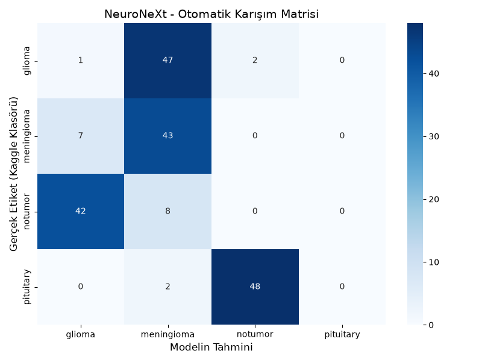
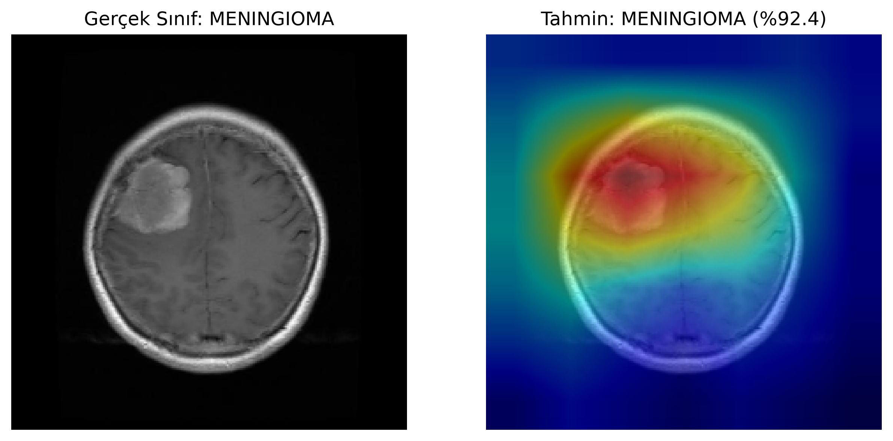

# MedERA AI

Beyin MR görüntüleri üzerinden tümör tespiti yapan derin öğrenme modelini, tıbbi PDF kaynaklarını tarayan yerel bir RAG (Retrieval-Augmented Generation) mimarisiyle birleştiren yapay zeka prototipi.

## Dosya Yapısı
- `train.py` & `evaluate.py`: Görüntü sınıflandırma modelinin eğitimi ve test değerlendirmesi
- `veritabani_olustur.py`: Tıbbi PDF kaynaklarından vektör veritabanı oluşturma
- `era_koprusu.py` & `klinik_raporu.py`: Model çıktıları ile yerel LLM/RAG yapısını bağlayarak klinik rapor üretme
- `arayuz.py`: Uygulamanın kullanıcı arayüzü

## Kullanılan Teknolojiler
- Python, PyTorch
- Yerel LLM & RAG Mimarisi

## Örnek Çıktılar

> *Not: Büyük boyutlu veri setleri, tıbbi PDF kaynakları ve eğitilmiş model ağırlıkları (`.pth`) GitHub dosya boyutu sınırı nedeniyle `.gitignore` ile hariç tutulmuştur.*
